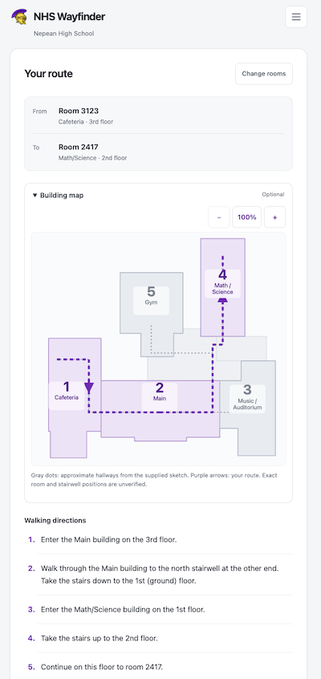
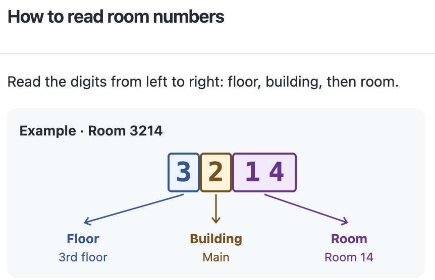
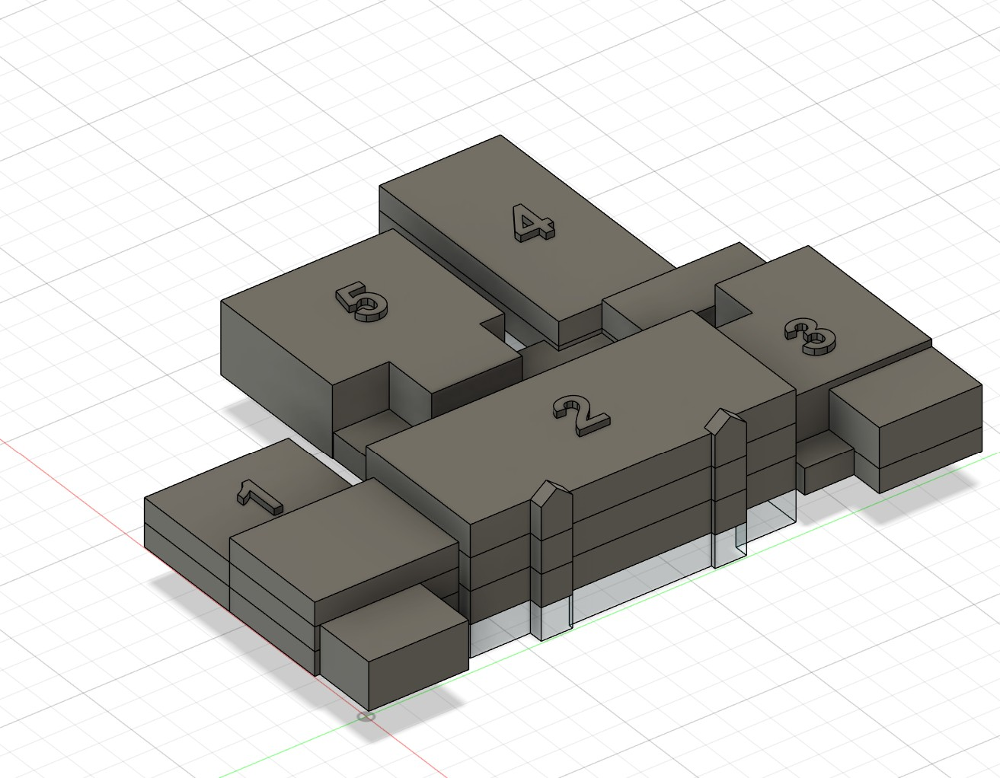

# Nepean HS Navigator

This app is aimed at Nepean HS parents, trying to navigate the confusing buildings and room numbers at parent-teacher interviews and other occasions. Enter the room you are in (or the door you came through) and the room you want to reach, and it gives you step-by-step walking directions between buildings and floors, with a map. It also explains how room numbers work and has shortcuts for destinations such as the Library, Guidance, Office, and Gym.

It's a Progressive Web App (PWA), which means you can view it as a web page while you have internet, but you can also save it as an app on your phone that works even if you're offline (deep within the halls of Nepean).

[Open NHS Wayfinder](https://stephencmorton.github.io/nepean-navigator/)

## Using the app

1. Enter your starting room, or select entrance **A**, **B**, **C**, or **N** using the letter above the door you came in. Entrances are starting points only; choose **Use a room instead** to switch back.
2. Enter your destination room, or tap one of the named destinations.
3. Select **Get directions**.

Room numbers have four digits: floor, building, and two room digits. You can omit the leading zero for basement rooms: enter `201` or `0201`.

The directions are a numbered sequence to follow. The map below them shows the whole school, with the floors you will use drawn for the buildings along your route. Where you change floors at a stairwell, the two floor drawings are joined at the stairs (marked with a zigzag), and the stairwells you use are circled with Up/Down labels. Room positions on the map are estimates; the written directions are the most accurate guide. On a phone, rotate to landscape for a larger map you can pinch to zoom and drag to pan.

## Understanding room numbering

You don't actually need this app (!!) if you just understand the way room and building numbering works.

## Offline use

You do not need an internet connection to use this app, as long as you *already* have it loaded in a browser tab on your phone. This is useful when you can't get a good connection inside NHS. To keep it even when you don't have it open in a tab, install it as a phone app (below).

## Turning it into a real phone app (iPhone or Android)

You can save the app to your phone, and it will behave just like any other app. In this mode, you can always use it without an internet connection. Open the "hamburger menu" in the top right, select "Save app for offline use", and follow the instructions.

## Limitations

1. **Map and room data.** This is a prototype based on my best memory of the buildings. Some connections are missing, and individual room locations have not been verified. Next parent-teacher night I will gather more accurate information.
2. **Accessibility.** Almost all routes may use stairs. This is a fundamental limitation of the buildings, not of the app.
3. **Basements.** The way down to the Main building's basement (building 2, floor 0) isn't mapped yet, and the route to the Music room in the Music/Auditorium basement (building 3, floor 0) is uncertain.
4. **Music/Auditorium rooms.** Many rooms on the 1st and 2nd floors of building 3 don't follow the usual numbering order and haven't been surveyed, so their map positions are estimates.
5. **Cafeteria.** The ground floor of the Art/English building (building 1, floor 1) is mapped as one large open room, the Cafeteria. Its other rooms and exits aren't mapped yet.

## Developing

The app is plain HTML, CSS, and JavaScript with no build step. The buildings don't change, so few further changes are expected, but if you want to correct the map data or work on the app, see [CONTRIBUTING.md](CONTRIBUTING.md).
