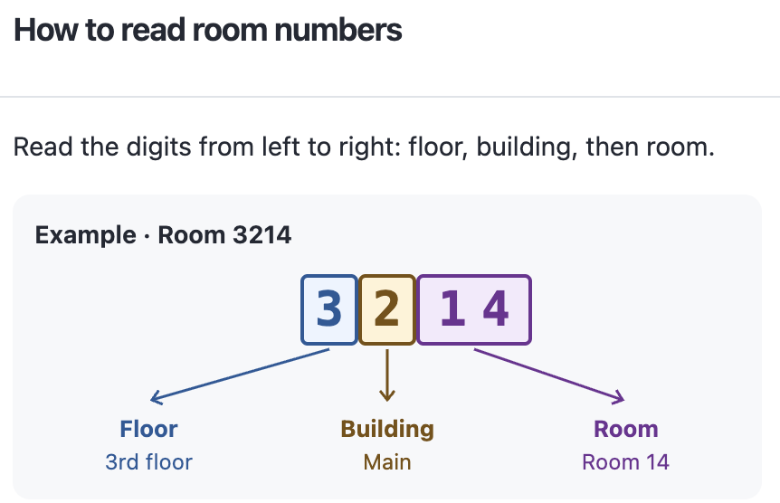
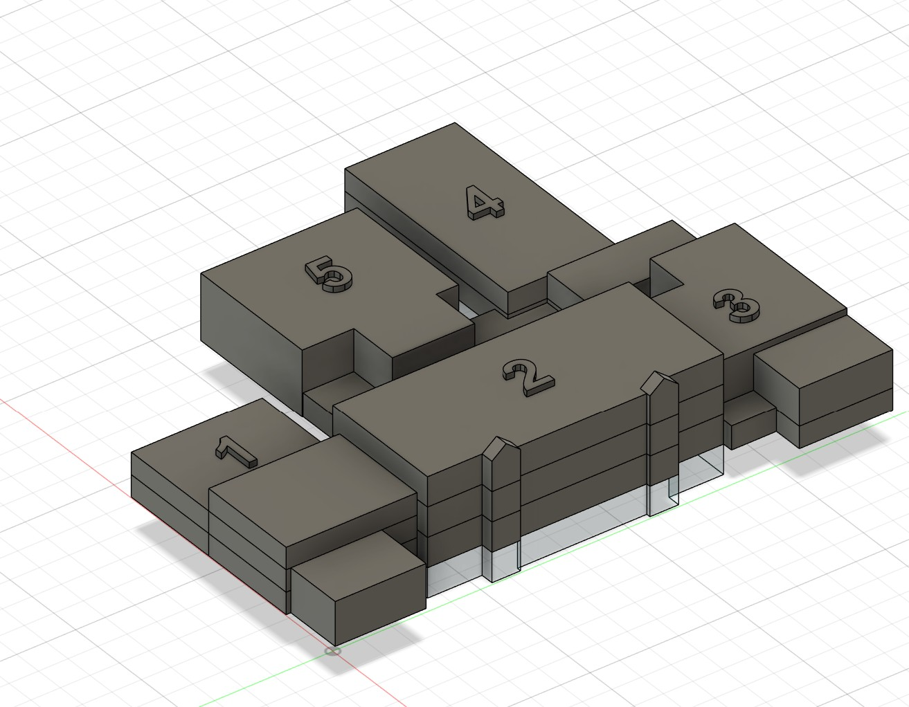
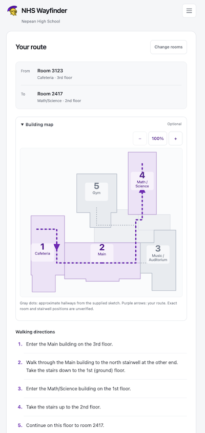

# Nepean HS Navigator

This app is aimed at Nepean HS parents, trying to navigate the confusing buildings and room numbers at parent teacher interviews and other occasions. It's a Progressive Web App (PWA) which means you can view it as a web page while you have internet, but you can save it as an app on your phone that works even if you're offline (deep within the halls of Nepean).

Find your way between rooms at Nepean High School. The app gives you directions between buildings and floors, explains room numbers, and includes shortcuts for destinations such as the Library, Guidance, Office, and Gym.

[Open NHS Wayfinder](https://stephencmorton.github.io/nepean-navigator/)

## Understanding room numbering

You don't need actually need this app (!!) if you just understand the way room- and building-numbering works.

<a href="docs/images/room-numbering.png">
  
</a>

<a href="docs/images/building-numbering.jpg">
  
</a>

## Using the app

Enter your starting room and destination, then select **Get directions**. Room numbers have four digits: floor, building, and two room digits. You can omit the leading zero for basement rooms: enter `501` or `0501`.

Walking directions provide a numbered sequence to follow. The written directions are the most accurate, but the 2D building map provides context so you can understand your approximate route, if you're a more spatial/visual person.



### Offline Use
You do not need an internet connection to use this app (as long as you *already* have it loaded in a browser tab on your phone). But to save it even if you don't have it in a tab, see the section below.

(Useful when you can't get a good internet connection inside NHS.)

### Turning it into a real phone app (iPhone or Android)
You may download the app to your phone, and it will behave just like any other app. In this mode, you can always use use it without an internet connection. Just click the "hamburger menu" in the top right, select "Save app for offlline use", and follow the instructions.

### Limitations

1. Map/Rooms Data
This is a prototype based on my best memory of the buildings. Some connections are missing, and individual room locations have not been verified. Next parent-teacher night I will gather more accurate information.

2. Accessibility
Almost all routes may use stairs. Stair-free access is not mapped.

## Editing the project

The app uses plain HTML, CSS, and JavaScript. There is no framework, build step, or dependency installation.

### Run it locally

With Python 3 installed, run this command from the repository folder:

```sh
python3 -m http.server 8000 --bind 127.0.0.1
```

Visit http://localhost:8000/, edit files, and reload the page. Stop the server with **Ctrl+C** in its terminal. Opening `index.html` directly will not work correctly because JavaScript modules and offline support need HTTP. Production offline support requires HTTPS.

### Where to make changes

| File | Purpose |
| --- | --- |
| [data.js](data.js) | School buildings, floor connections, stairs, and special destinations |
| [route-map.js](route-map.js) | Optional SVG building overview for the walking route |
| [routing.js](routing.js) | Room parsing, route finding, and written directions |
| [app.js](app.js) | Form behaviour, results, installation help, and service-worker registration |
| [index.html](index.html) and [style.css](style.css) | Page content, structure, and appearance |
| [manifest.webmanifest](manifest.webmanifest) and [icons/](icons/) | App installation details and icons |
| [sw.js](sw.js) | Offline caching and app updates |
| [tests/](tests/) | Automated routing and offline-cache checks |

For map edits, room numbers use **floor-building-room digits**, while connection keys use **building-floor**. For example, room `2412` belongs to node `4-2`. Connections are automatically bidirectional. Check school-map corrections against the actual building before treating them as confirmed.

The building outlines and schematic connector coordinates live in `mapLayout` in `data.js`. These are display geometry only; routing connections still come from `school.connections` and `school.staircases`. Keep their roles separate when editing. Original top-view and isometric reference images are in [references/maps/](references/maps/); those development references are not deployed with the app.

### Check your changes

With Node.js 22 or newer installed, run:

```sh
node --test
```

Also try your changes in a browser, including a narrow mobile view and keyboard navigation. For changes to offline behaviour, let the app install online, switch the browser to offline mode, reload, and request a route.

When changing any deployed app asset, bump `VERSION` in `sw.js` so returning users receive the update. Documentation-only changes do not need a version bump. New versions wait for existing app tabs to close; close all app tabs/windows and reopen online to update. If cached files hide local edits, unregister the service worker and clear this site's cache in browser DevTools.

### Publishing

The repository includes a [GitHub Pages workflow](.github/workflows/pages.yml). Pull requests to `main` run tests; pushes to `main` run tests and deploy the app. Manual deployment also runs only on `main`. In GitHub's repository settings, Pages must use **GitHub Actions** as its source, and the `github-pages` environment must permit `main`.

The app can also be served by another static host at a domain root or a repository subpath. Keep the directory structure intact and use a trailing slash in the site URL. The included deployment automation is specific to GitHub; a GitLab copy would need its own deployment configuration.

Coding agents should also read [AGENTS.md](AGENTS.md) for implementation constraints and detailed verification steps.
